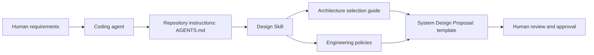
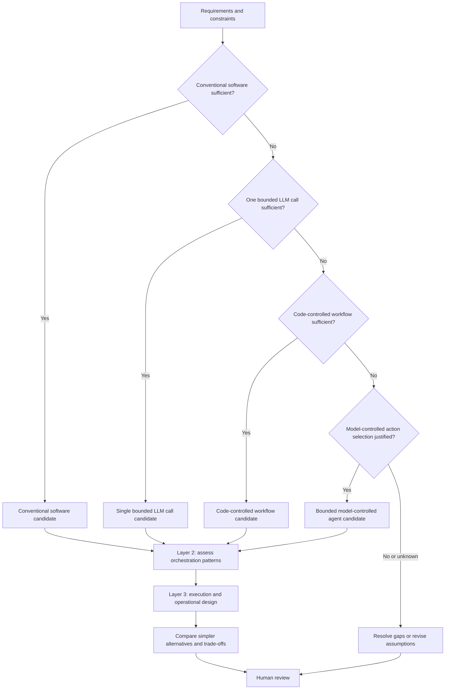
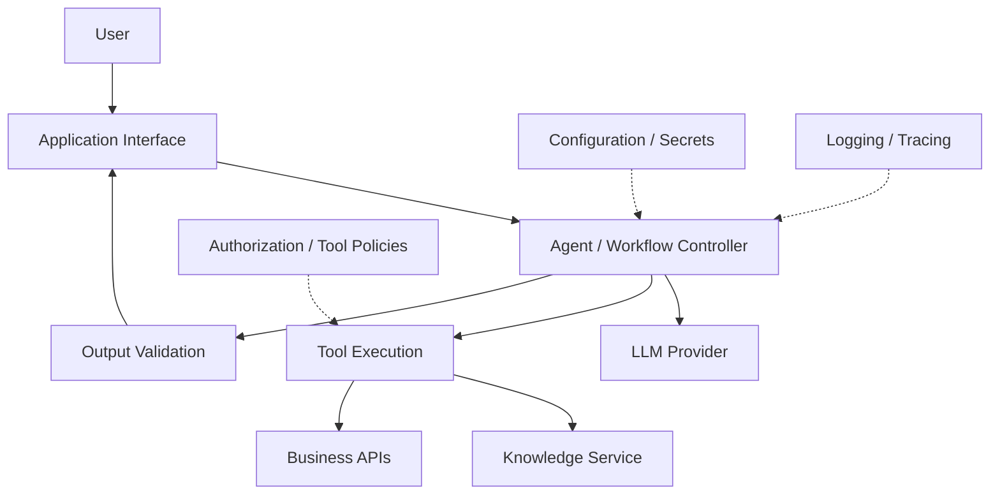
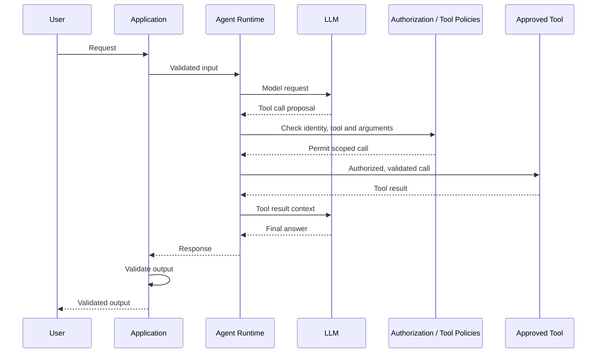

# Production Agent Starter

*Design AI agent systems with explicit architecture decisions and engineering constraints.*

Production Agent Starter is a framework-neutral architecture design toolkit for coding agents, engineers, and project owners. It turns system requirements into structured, reviewable **System Design Proposals**.

It helps determine whether a problem calls for conventional software, a single bounded LLM call, a code-controlled workflow, or a bounded model-controlled agent. Each proposal records the rationale, alternatives, editable diagrams, applicable engineering policies, verification plans, and questions for human review.

## Why this project exists

- **Architecture before framework.** Compare conventional software, a single bounded LLM call, a code-controlled workflow, and a model-controlled agent against the requirements before choosing an SDK.
- **Explicit control boundaries.** Separate model-directed decisions from application-controlled execution, permissions, and termination.
- **Production-minded engineering.** Address authorization, reliability, execution budgets, observability, failure handling, and verification during design.
- **Reviewable architecture decisions.** Record rationale, alternatives, trade-offs, acceptance criteria, and questions for human approval.

## What it produces

The reusable procedure in [`skills/agent-system-design/SKILL.md`](skills/agent-system-design/SKILL.md) guides a coding agent through requirements, architecture choices, and applicable engineering policies. Its output follows [`templates/SYSTEM_DESIGN.md`](templates/SYSTEM_DESIGN.md): a proposal with a control strategy, orchestration and operational design, alternatives, editable Mermaid diagrams, Policy ID assessments, proposed tests, evidence gaps, and decisions for human approval. The same procedure can be applied to each new requirement without changing repository files.

### Scope and limits

| This project guides | This project does not provide |
| --- | --- |
| Requirements-to-architecture reasoning | A new orchestration engine or LLM gateway |
| Workflow and agent pattern selection | Guaranteed universal pattern recommendations |
| Editable, reviewable system-design diagrams | A finished drag-and-drop architecture builder |
| Policies for tool use, failure handling, and verification | Certified security, production deployment, or compliance |
| Coding-agent implementation handoff | A working universal scaffold/code generator |

## Quick Start — design a system

1. **Clone or download.** On GitHub, use **Code → Download ZIP** and extract it, or copy the clone URL and run `git clone <repository-url>`.
2. **Open the repository** in a coding-agent environment that can read its files. No installation or model API key is needed to use the documents. Instruction loading and Skill discovery vary by tool, so the prompt below names the public guidance explicitly.
3. **Provide requirements.** Replace the prompt placeholders with a concrete system goal, users, data sources, external actions, and constraints. Mark unresolved facts **unknown**.
4. **Review and approve the proposal.** Review the proposed architecture, challenge assumptions and selected patterns, resolve material unknowns, and check authorization and engineering-policy decisions. Approve the [System Design Proposal](templates/SYSTEM_DESIGN.md) or request revisions before implementation. The coding agent cannot approve its own proposal.

The proposal appears in the coding-agent conversation by default. Save it as Markdown only when the user explicitly requests a file and provides or approves its destination; do not create an arbitrary proposal file in the repository. This is a documented design workflow, not a command-line tool or automatic architecture selector.

**Prompt to copy into a coding agent:**

```text
Read README.md and AGENTS.md in Production Agent Starter. Follow
skills/agent-system-design/SKILL.md as the design procedure, whether or not
your tool discovers Skills automatically. Consult docs/ARCHITECTURE_SELECTION.md
and docs/ENGINEERING_POLICIES.md; use templates/SYSTEM_DESIGN.md for the output.
Problem: [what I want to build]
Users and data sources: [who/what]
External actions: [read-only / write / unknown]
Constraints: [budget, latency, security, deployment, skills]

Produce a System Design Proposal, not application code. Compare conventional
software, one bounded LLM call, a code-controlled workflow, and a bounded
model-controlled agent. Justify the control strategy, orchestration patterns,
execution and operational design, simpler alternatives, and trade-offs.
Include editable Mermaid component and request sequence diagrams, relevant
Policy IDs with DESIGN-stage evidence gaps, proposed tests, and questions
requiring my approval. Keep framework and model choices separate. Label
known, assumed, unknown, proposed, and verified facts. Present the proposal
in this conversation. Save a Markdown file only if I explicitly request one
and provide or approve its destination. Stop for my review before implementation.
```

### Diagram A — Repository workflow

This diagram shows how repository instructions, design procedures, and engineering references support the proposal. It describes documentation guidance and responsibilities, not an executable runtime or mandatory sequential loading mechanism.



The methods remain framework-neutral. The **first planned hands-on example** may use LangChain/LangGraph; this is not a requirement for users' designs.

## Customization & Extensions

[`AGENTS.md`](AGENTS.md) sets general repository working rules, the [design Skill](skills/agent-system-design/SKILL.md) defines the architecture procedure, and the [Engineering Policies](docs/ENGINEERING_POLICIES.md) define applicable control requirements. For your own project, you can add specialized guidance without changing those core documents:

- Project instructions for coding style, language or framework preferences, testing, quality, and domain documentation.
- Optional domain-specific Skills and tool-specific instruction files.
- Formatter, linter, and test configurations for the development tools you use.

For example, a Python project could state its formatting and pytest conventions in its own instructions and supply matching tool configuration. This repository does not ship those configurations. Codex, Claude Code, Gemini CLI, and other tools may load instructions and discover Skills differently; follow each tool's conventions and reference files explicitly when needed. A plugin is not required. Additional instructions or Skills cannot grant execution authority, bypass applicable policies, or replace human approval.

## Architecture selection

Control flow, collaboration, technology, and model interfaces are **separate decisions**. Multiple patterns may coexist within one system; retrieval, memory, HITL, persistence, and observability are capabilities—not mutually exclusive agent topologies.

### Diagram B — Architecture decision guide (summary)



**Important:** This is a reasoning heuristic, not an automatic selector. A code-controlled workflow may call models and tools; tool use alone does not imply a model-controlled agent. Layer 2 assesses patterns without requiring them, and Layer 3 does not require a graph runtime. Resolve material unknowns during review. The [detailed selection guide](docs/ARCHITECTURE_SELECTION.md) explains criteria, composition, and trade-offs.

### Pattern map

| Layer | Options | Design question |
| --- | --- | --- |
| 1. Control strategy | Conventional software; single bounded LLM call; code-controlled workflow; bounded model-controlled agent | Who selects the next step, and is a model needed? |
| 2. Orchestration | Sequential; parallel; router; evaluator–optimizer; supervisor; handoff, when justified | How should stages or specialists coordinate? |
| 3. Execution and operations | Ordinary code or graph representation; state, recovery, authorization, budgets, observability | How will the selected design run and fail safely? |

Pattern names describe engineering approaches, not a single universal or exhaustive taxonomy. For research context, see [Anthropic: Building Effective Agents](https://www.anthropic.com/engineering/building-effective-agents) and [LangGraph: Workflows and Agents](https://docs.langchain.com/oss/python/langgraph/workflows-agents).

## From architecture choice to system design

The output we want a coding agent to prepare is a **design proposal**, not a claim that software has been built. A useful proposal identifies requirements (including unknowns), the chosen pattern and alternatives, components and interfaces, model/tool integrations, trust boundaries, failures, quality gates, acceptance tests, implementation tasks, and conditions that would trigger redesign.

### Diagram C — Example system architecture

The following **illustrative** enterprise knowledge assistant is one possible outcome, not a mandatory architecture or a shipped application.



### Diagram C.1 — Example request sequence

This shows the successful path only. Production designs also need denied-action, timeout, cancellation, invalid-output, and tool-failure paths.



**Diagram quality rule:** each important component must have a documented responsibility; trust boundaries and major external interfaces must be visible or explicitly described. Keep source diagrams editable. Do not pretend that a success-path sequence proves all failure paths are safe.

## Framework and model strategy

This project recommends **architectures**, not mandatory SDKs. Framework-free implementation is a valid option. The *first example* may use LangChain/LangGraph; other SDKs may be evaluated later.

LangChain and LangGraph are open source; hosted inference can still incur API costs. Supporting one model endpoint does not establish universal provider compatibility: tool calling, structured outputs, context limits, streaming, error semantics, and local model capabilities must be checked for the chosen combination.

## Engineering principles

- **Minimal complexity:** justify each additional agent, workflow stage, persistence layer, or integration.
- **Least privilege:** model suggestions are not authorization. Enforce tool schemas and user permissions outside prompts.
- **Bounded execution:** identify model/tool deadlines, retries, budgets, and loop limits; never silently mask failure.
- **Safe side effects:** verify identity, approvals, idempotency, and auditability for write operations.
- **Protected data:** never commit keys or log sensitive prompts/tool payloads by default.
- **Verification:** separate deterministic tests, live-model evaluations, and deployment-specific security checks.
- **Traceability:** tie critical decisions to requirements and acceptance criteria.

## Roadmap

| Milestone | Status |
| --- | --- |
| Architecture Design Toolkit | **Available** — documented guides, Skill, and proposal template; no tested automation |
| Architecture Validation Cases | **Planned** — Simple FAQ, Multi-domain Customer Support, and Internal HR Assistant have not been run |
| Executable Reference Examples | **Planned** — may use LangChain/LangGraph, with a separate offline path |
| Production Engineering Extensions | **Future** — no runtime, code generator, UI, deployment platform, or production certification |

## Technical Foundations & References

The architecture methodology draws on established agent engineering patterns, software architecture principles, and production engineering practices. This repository organizes them into a requirement-driven design and review workflow.

- [Anthropic — Building Effective Agents](https://www.anthropic.com/engineering/building-effective-agents)
- [LangGraph — Workflows and Agents](https://docs.langchain.com/oss/python/langgraph/workflows-agents)
- [LangChain — Agents](https://docs.langchain.com/oss/python/langchain/agents)
- [Google ADK — Workflow Agents](https://adk.dev/agents/workflow-agents/)
- [OpenAI Agents SDK — Multi-agent Orchestration](https://openai.github.io/openai-agents-python/multi_agent/)
- [ReAct — Yao et al.](https://arxiv.org/abs/2210.03629)
- [C4 Model](https://c4model.com/) · [Mermaid](https://mermaid.js.org/)
- [Agent Skills Specification](https://agentskills.io/specification)
- [OWASP — Agentic Application Security](https://genai.owasp.org/)

## License

Licensed under the Apache License, Version 2.0. See [LICENSE](LICENSE) for details.
