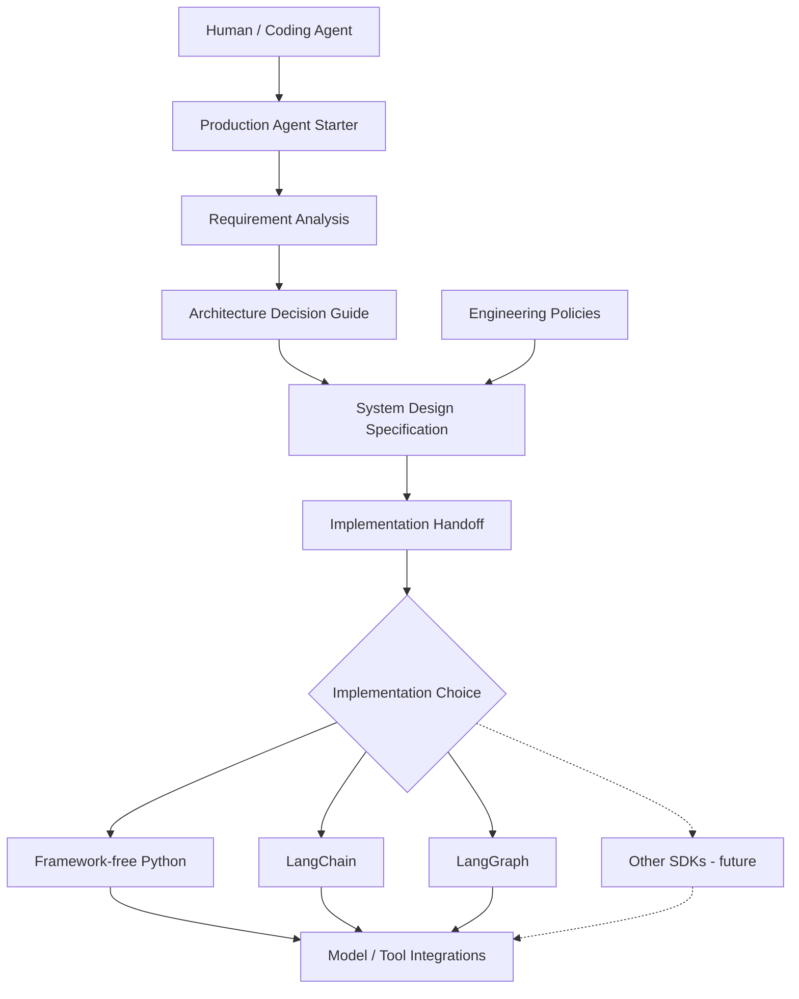
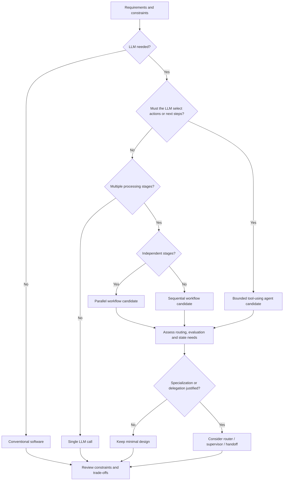
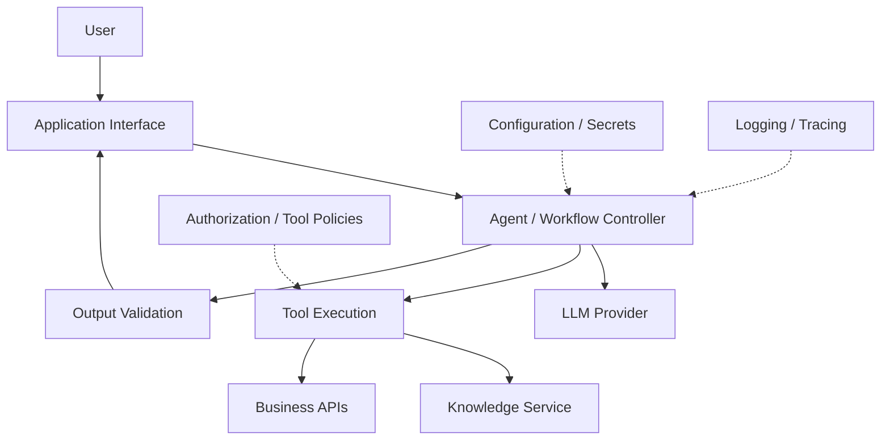
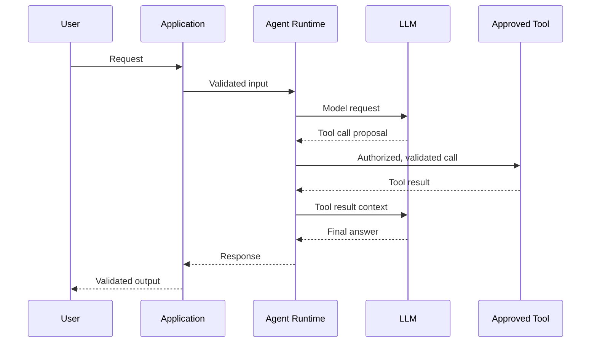
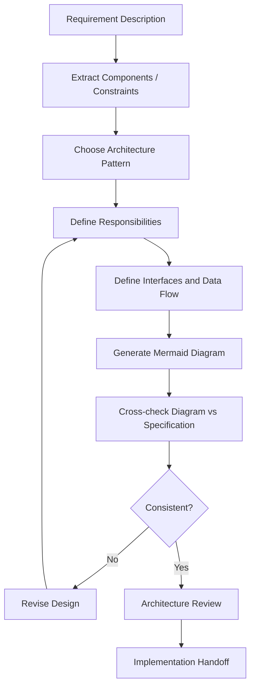

# Production Agent Starter

**Design the agent system before choosing the agent framework.**

*A lightweight, framework-neutral reference for turning requirements into justified architecture decisions, editable diagrams, engineering constraints, and an implementation plan that a human or coding agent can review and execute.*

> **Status — Documentation foundation.** This repository currently contains this design reference and [`AGENTS.md`](AGENTS.md). The reusable Skill, detailed decision guide, design template, tested examples, and runtime are **not yet shipped**. The diagrams below are *conceptual guidance*, not evidence of a working architecture generator or production deployment.

## Why this project exists

An agent framework can execute workflows, call tools, or coordinate models; it cannot decide whether your particular problem requires an autonomous agent in the first place. Beginning with an SDK too often obscures the actual engineering questions: which decisions should be deterministic, what the model may control, where authorization belongs, what failure looks like, and how the result will be tested.

**Production Agent Starter addresses the design process, not the agent runtime.** Its intended users are engineers, project owners, and coding agents. It favors the simplest architecture that satisfies the stated requirements, including **no LLM**, **one model call**, or **framework-free Python** when appropriate.

The guiding principle is **Architecture first · Framework second · Model integration third · Verification always.**

### What it is—and is not

| This project guides | This project does not provide |
| --- | --- |
| Requirements-to-architecture reasoning | A new orchestration engine or LLM gateway |
| Workflow and agent pattern selection | Guaranteed universal pattern recommendations |
| Editable, reviewable system-design diagrams | A finished drag-and-drop architecture builder |
| Policies for tool use, failure handling, and verification | Certified security, production deployment, or compliance |
| Coding-agent implementation handoff | A working universal scaffold/code generator |

## Start here

**Today:** Read this README and [`AGENTS.md`](AGENTS.md), then give your coding agent a concrete problem statement. The following workflow is a **manual, documented process**, not a command-line tool.

1. Describe users, goals, success criteria, data sources, external actions, budget, latency, privacy, and deployment constraints. Mark unanswered questions as **unknown**, not false.
2. Decide whether conventional code, a bounded LLM call, a deterministic workflow, or an agent-controlled tool loop is necessary.
3. Compare at least one simpler alternative; select or compose control-flow and collaboration patterns.
4. Define responsibilities, interfaces, trust boundaries, and failure behavior; draw editable diagrams.
5. Select an implementation approach and model integration *after* the design is justified.
6. Produce a reviewable design proposal with acceptance tests. **Approve it before writing code.**

**Prompt to copy into a coding agent:**

```text
Read README.md and AGENTS.md in Production Agent Starter.
Problem: [what I want to build]
Users and data sources: [who/what]
External actions: [read-only / write / unknown]
Constraints: [budget, latency, security, deployment, skills]

Design before implementing. Determine if an LLM or autonomous agent is needed.
Compare the simplest viable solution with at least one alternative.
Recommend architecture pattern(s), with reasons and revision triggers.
Provide a Mermaid component diagram and an example request sequence.
Document interfaces, trust boundaries, failures, verification, and open questions.
Recommend framework-free or framework-based implementation separately from model choice.
Clearly distinguish proposed, illustrative, verified, and unknown details.
Stop for my approval before generating the application.
```

## Diagram A — What this repository does

This is the **design-guidance workflow**, not a diagram of a runtime supplied by the repository.



The methods should remain framework-neutral. The **first planned hands-on example** will prioritize the open-source LangChain/LangGraph ecosystem; this is not a requirement imposed on users.

## Architecture selection

Control flow, collaboration, technology, and model interfaces are **separate decisions**. Multiple patterns may coexist within one system; retrieval, memory, HITL, persistence, and observability are capabilities—not mutually exclusive agent topologies.

### Diagram B — Architecture decision guide (preliminary)



**Important:** This tree is an *explanatory heuristic*, not an automatic selector. A deterministic workflow can call tools; tool use alone does not imply an autonomous agent. Parallelism, routing, and supervisor designs require independent justification based on task dependencies, quality evidence, latency, costs, tool permissions, and maintainability. A robust recommendation includes a simpler alternative and unresolved assumptions.

### Pattern map

| Layer | Options | Design question |
| --- | --- | --- |
| Baseline | Conventional logic; single LLM call | Do we need an agent at all? |
| Model-driven execution | Bounded tool-using agent / ReAct | What may the model choose or invoke? |
| Workflow | Sequential; parallel; router; evaluator–optimizer | Which steps are fixed, independent, conditional, or iterative? |
| Planning and coordination | Plan-and-execute; orchestrator–worker; supervisor; handoff | Is delegation or dynamic planning justified? |
| Stateful execution | Loop; custom graph; checkpoints | What must be resumed, interrupted, or persisted? |
| Cross-cutting | Retrieval; memory; approval; tool policies; evaluation | What additional capabilities and safeguards are needed? |

Pattern names describe engineering approaches, not a single universal or exhaustive taxonomy. For research context, see [Anthropic: Building Effective Agents](https://www.anthropic.com/engineering/building-effective-agents) and [LangGraph: Workflows and Agents](https://docs.langchain.com/oss/python/langgraph/workflows-agents).

## From architecture choice to system design

The output we want a coding agent to prepare is a **design proposal**, not a claim that software has been built. A useful proposal identifies requirements (including unknowns), the chosen pattern and alternatives, components and interfaces, model/tool integrations, trust boundaries, failures, quality gates, acceptance tests, implementation tasks, and conditions that would trigger redesign.

### Diagram C — Example system architecture

The following **illustrative** enterprise knowledge assistant is one possible outcome, not a mandatory architecture or a shipped application.



### Diagram C.1 — Example request sequence

This shows the successful path only. Production designs also need denied-action, timeout, cancellation, invalid-output, and tool-failure paths.



### Diagram D — How to generate and review the diagrams

Mermaid output is not the deliverable on its own; it must agree with the text and the security model.



**Diagram quality rule:** each important component must have a documented responsibility; trust boundaries and major external interfaces must be visible or explicitly described. Keep source diagrams editable. Do not pretend that a success-path sequence proves all failure paths are safe.

## Framework and model strategy

This project recommends **architectures**, not mandatory SDKs. Framework-free Python is a valid option. LangChain/LangGraph is the preferred ecosystem for the *first example*, not a universal recommendation. Other agent SDKs may be discussed and evaluated later.

LangChain and LangGraph are open source; hosted inference can still incur API costs. Supporting one model endpoint does not establish universal provider compatibility: tool calling, structured outputs, context limits, streaming, error semantics, and local model capabilities must be checked for the chosen combination.

## Engineering principles

- **Minimal complexity:** justify each additional agent, workflow stage, persistence layer, or integration.
- **Least privilege:** model suggestions are not authorization. Enforce tool schemas and user permissions outside prompts.
- **Bounded execution:** identify model/tool deadlines, retries, budgets, and loop limits; never silently mask failure.
- **Safe side effects:** verify identity, approvals, idempotency, and auditability for write operations.
- **Protected data:** never commit keys or log sensitive prompts/tool payloads by default.
- **Verification:** separate deterministic tests, live-model evaluations, and deployment-specific security checks.
- **Traceability:** tie critical decisions to requirements and acceptance criteria.

## Project status and planned work

| Deliverable | Status |
| --- | --- |
| Public positioning, conceptual workflow, architecture diagrams | **Present — documentation** |
| Root coding-agent instructions (`AGENTS.md`) | **Present** |
| Detailed selection guide, pattern recipes, design template | **Planned** |
| Reusable `SKILL.md` and Codex workflow | **Planned** |
| Tested LangChain/LangGraph Jupyter example | **Planned** |
| Runtime, code generator, UI, deployment platform | **Not provided** |

Future examples should offer an offline deterministic path alongside clearly marked optional model API calls. No security certification or production-readiness claim is made.

## Research and further reading

This project synthesizes external work; the linked authors do not endorse this particular design methodology.

- [Anthropic — Building Effective Agents](https://www.anthropic.com/engineering/building-effective-agents)
- [LangGraph — Workflows and Agents](https://docs.langchain.com/oss/python/langgraph/workflows-agents)
- [LangChain — Agents](https://docs.langchain.com/oss/python/langchain/agents)
- [Google ADK — Workflow Agents](https://adk.dev/agents/workflow-agents/)
- [OpenAI Agents SDK — Multi-agent Orchestration](https://openai.github.io/openai-agents-python/multi_agent/)
- [ReAct — Yao et al.](https://arxiv.org/abs/2210.03629)
- [C4 Model](https://c4model.com/) · [Mermaid](https://mermaid.js.org/)
- [Agent Skills Specification](https://agentskills.io/specification)
- [OWASP — Agentic Application Security](https://genai.owasp.org/)

## License

**Not selected yet.** Apache-2.0 has been discussed, but the license must be explicitly chosen and added before public publication. Until then, public visibility alone does not grant broad reuse rights.
