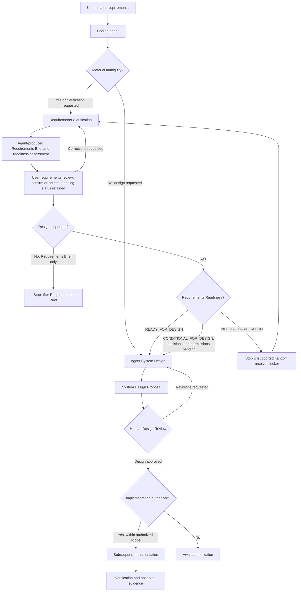
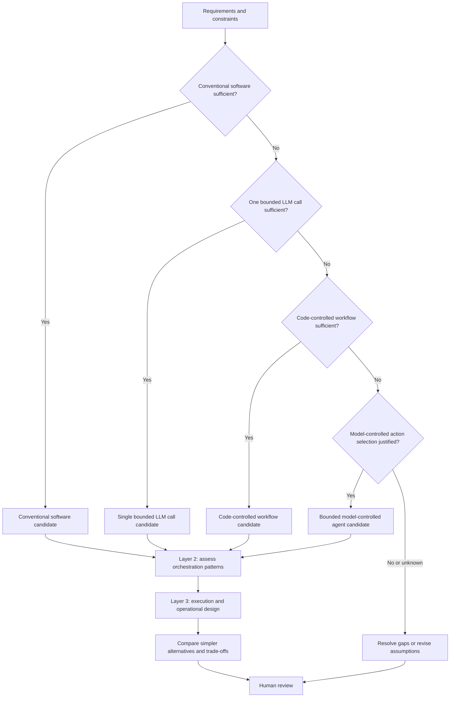
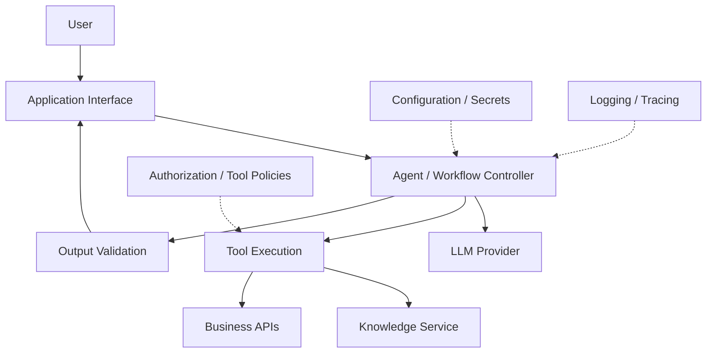
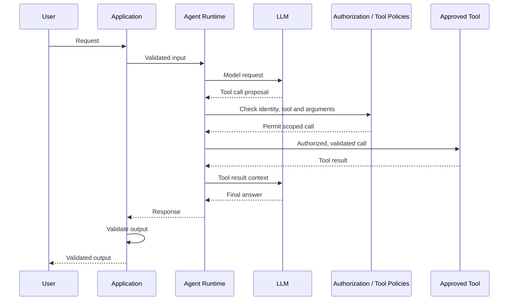

# Production Agent Starter

*Design AI agent systems with explicit architecture decisions and engineering constraints.*

Production Agent Starter is a framework-neutral architecture design toolkit for coding agents, engineers, and project owners. It helps clarify incomplete requirements when needed and turns sufficiently understood requirements into reviewable **System Design Proposals**.

It helps determine whether a problem calls for conventional software, a single bounded LLM call, a code-controlled workflow, or a bounded model-controlled agent. Each proposal records the rationale, alternatives, editable diagrams, applicable engineering policies, verification plans, and questions for human review.

## Why this project exists

- **Architecture before framework.** Compare conventional software, a single bounded LLM call, a code-controlled workflow, and a model-controlled agent against the requirements before choosing an SDK.
- **Explicit control boundaries.** Separate model-directed decisions from application-controlled execution, permissions, and termination.
- **Production-minded engineering.** Address authorization, reliability, execution budgets, observability, failure handling, and verification during design.
- **Reviewable architecture decisions.** Record rationale, alternatives, trade-offs, acceptance criteria, and questions for human approval.

## What it produces

- **Requirements Brief, when clarification is needed.** The [Requirements Clarification Skill](skills/requirements-clarification/SKILL.md) captures goals and users; functional, non-functional, and security requirements with stable IDs; scope and acceptance criteria; constraints and researched context; assumptions, unknowns, open decisions, readiness, and user confirmation status. Clear requirements can skip this process.
- **System Design Proposal.** The [Agent System Design Skill](skills/agent-system-design/SKILL.md) follows the [System Design Template](templates/SYSTEM_DESIGN.md): three-layer architecture decisions including comparison of four control strategies, justified orchestration and execution choices, alternatives and trade-offs, module structure, component responsibilities and dependencies, interface/data/error contracts, editable Mermaid architecture and sequence diagrams, selective design-level pseudocode or illustrative code, engineering controls and applicable Policy IDs, proposed acceptance tests, evidence gaps, and implementation Work Packages with approval boundaries.

The proposal supports a subsequent coding agent's implementation planning. It is a reviewable design, not a working application, universal scaffold, tested deployment, production-readiness proof, or implementation authorization. Both procedures can be reused for new requirements without changing repository files.

## What you can do with Production Agent Starter

| Capability | What you get |
| --- | --- |
| Requirements Clarification | Turn incomplete ideas into structured requirements, acceptance criteria, and explicit open decisions. |
| Architecture Decision-Making | Select the smallest justified architecture, from conventional software to bounded AI agents. |
| System Design Proposals | Produce reviewable designs with component responsibilities, interfaces, data contracts, and editable diagrams. |
| Production Engineering Considerations | Address security, authorization, reliability, observability, and failure handling during design. |
| Implementation Handoff | Prepare implementation Work Packages and verification criteria for subsequent, explicitly authorized development. |

> **Scope:** Production Agent Starter is a design-time toolkit, not an agent runtime or automatic code generator. It produces reviewable architecture proposals and implementation handoffs. Actual implementation, testing, and deployment are separate activities requiring appropriate authorization.

## Repository Structure

```text
.
├── README.md
├── AGENTS.md
├── LICENSE
├── docs/
│   ├── ARCHITECTURE_SELECTION.md
│   └── ENGINEERING_POLICIES.md
├── skills/
│   ├── requirements-clarification/
│   │   ├── SKILL.md
│   │   └── README.md
│   └── agent-system-design/
│       ├── SKILL.md
│       ├── README.md
│       └── DESIGN.md
└── templates/
    └── SYSTEM_DESIGN.md
```

| Path | Responsibility |
| --- | --- |
| [README.md](README.md) | Developer-facing documentation and usage. |
| [AGENTS.md](AGENTS.md) | Repository-level coding-agent instructions. |
| [skills/](skills/) | Independent, reusable coding-agent procedures. |
| [skills/requirements-clarification/](skills/requirements-clarification/) | Requirements clarification and the Requirements Brief. |
| [skills/agent-system-design/](skills/agent-system-design/) | Architecture design and the System Design Proposal. |
| [docs/](docs/) | Architecture selection methodology and engineering policies. |
| [templates/](templates/) | Structured output contract for design proposals. |

The two Skills are independently usable. Clarification is optional when requirements are sufficiently understood; those requirements can go directly to Agent System Design. When clarification is used, the Requirements Brief provides shared context for the design handoff.

## Quick Start — design a system

1. **Clone or download.** On GitHub, use **Code → Download ZIP** and extract it, or copy the clone URL and run `git clone <repository-url>`.
2. **Open the repository** in a coding-agent environment that can read its files. No installation or model API key is needed to use the documents. Instruction loading and Skill discovery vary by tool, so the prompt below names the public guidance explicitly.
3. **Share an idea or requirements.** Use the prompt below with what you know; leave other fields unspecified or write **UNKNOWN**. You do not need every requirement or a framework/model choice first. The agent checks actual scope, acceptance, and authority, clarifies material ambiguity, and skips an unnecessary interview when requirements are clear. You may request only a Requirements Brief.
4. **Review the deliverables.** Confirm or correct a Requirements Brief when one is used. For a System Design Proposal, challenge assumptions and selected patterns, review material unknowns, and check authorization and engineering-policy decisions. An authorized human approves the design or requests revisions; the agent cannot self-approve. Implementation requires separate authorization of its scope.

Both artifacts appear in the conversation by default. Save Markdown only when the user explicitly requests a file and provides or approves its destination; do not create arbitrary repository files. The Skills are documented procedures that agents can read directly, without a plugin, runtime, provider SDK, or automatic Skill invocation mechanism.

When clarification is used, the Brief records one readiness state:

| Requirements Readiness | Meaning for design handoff |
| --- | --- |
| READY_FOR_DESIGN | Requirements support architecture design without an unresolved central blocker. |
| CONDITIONAL_FOR_DESIGN | A provisional proposal is defensible; affected decisions and permissions remain pending. |
| NEEDS_CLARIFICATION | A fundamental blocker prevents a defensible design handoff; stop handoff and identify what must be clarified. |

Readiness is separate from User Confirmation of intent. Neither state approves architecture or grants data access, action permissions, or implementation authority.

**Prompt to copy into a coding agent:**

```text
Read README.md and AGENTS.md in Production Agent Starter.
Requested result: [System Design Proposal / Requirements Brief only]
Idea or problem: [...]
Intended users: [if known]
Existing systems or data sources: [if known]
External actions or permissions: [if known]
Constraints: [if known; UNKNOWN or omitted fields are fine]

Assess whether the actual requirements are sufficient. For material ambiguity,
follow skills/requirements-clarification/SKILL.md: reuse supplied information,
research authorized facts, ask focused questions, and produce a Requirements
Brief for confirmation. Carry its IDs, evidence, assumptions, unknowns,
readiness, and confirmation state forward. Skip unnecessary clarification
when requirements are clear. If I request only a Brief, stop there.

When I request design and a defensible design is possible, follow
skills/agent-system-design/SKILL.md. Do not bypass NEEDS_CLARIFICATION.
For a Brief marked CONDITIONAL_FOR_DESIGN, keep the architecture proposal
provisional and carry pending decisions and permissions forward.
Apply the methodology in docs/ARCHITECTURE_SELECTION.md, determine policy applicability, and follow all applicable requirements in docs/ENGINEERING_POLICIES.md.
Use templates/SYSTEM_DESIGN.md as the proposal output contract, including
architecture rationale, contracts, diagrams, controls, proposed tests,
evidence gaps, and Work Packages for authorized human review.

The proposal may contain concise, labeled pseudocode or illustrative code.
Do not create application source files, generate a working scaffold, execute
illustrative code, or begin implementation under this design request.
Present outputs in this conversation; save Markdown only if I explicitly
request a file and provide or approve its destination. Stop for human design
review; implementation requires separate authorization.
```

### Diagram A — End-to-End User Workflow

This conceptual documentation workflow supports direct design or optional clarification. It does not represent an executable orchestrator or a fixed document-loading sequence.



[`AGENTS.md`](AGENTS.md) supplies repository working rules. The [Architecture Selection Guide](docs/ARCHITECTURE_SELECTION.md) and [Engineering Policies](docs/ENGINEERING_POLICIES.md) support the design Skill; [`SYSTEM_DESIGN.md`](templates/SYSTEM_DESIGN.md) defines its output contract. Design approval leaves implementation authorization as a separate decision.

The methods remain framework-neutral. The **first planned hands-on example** may use LangChain/LangGraph; this is not a requirement for users' designs.

## Customization & Extensions

[`AGENTS.md`](AGENTS.md) sets general working rules, [Requirements Clarification](skills/requirements-clarification/SKILL.md) structures incomplete requirements, [Agent System Design](skills/agent-system-design/SKILL.md) defines the architecture procedure, and the [Engineering Policies](docs/ENGINEERING_POLICIES.md) define applicable controls. For your own project, you can add specialized guidance without changing those core documents:

- Project instructions for coding style, language or framework preferences, testing, quality, and domain documentation.
- Optional domain-specific Skills and tool-specific instruction files.
- Formatter, linter, and test configurations for the development tools you use.

For example, a Python project could state its formatting and pytest conventions in its own instructions and supply matching tool configuration. This repository does not ship those configurations. Codex, Claude Code, Gemini CLI, and other tools may load instructions and discover Skills differently; follow each tool's conventions and reference files explicitly when needed. A plugin is not required. Additional instructions or Skills cannot grant execution authority, bypass applicable policies, or replace human approval.

## Architecture selection

Control flow, collaboration, technology, and model interfaces are **separate decisions**. Multiple patterns may coexist within one system; retrieval, memory, HITL, persistence, and observability are capabilities—not mutually exclusive agent topologies.

### Diagram B — Architecture decision guide (summary)



**Important:** This is a reasoning heuristic, not an automatic selector. A code-controlled workflow may call models and tools; tool use alone does not imply a model-controlled agent. Layer 2 assesses patterns without requiring them, and Layer 3 does not require a graph runtime. Resolve material unknowns during review. The [detailed selection guide](docs/ARCHITECTURE_SELECTION.md) explains criteria, composition, and trade-offs.

### Pattern map

| Layer | Options | Design question |
| --- | --- | --- |
| 1. Control strategy | Conventional software; single bounded LLM call; code-controlled workflow; bounded model-controlled agent | Who selects the next step, and is a model needed? |
| 2. Orchestration | Sequential; parallel; router; evaluator–optimizer; supervisor; handoff, when justified | How should stages or specialists coordinate? |
| 3. Execution and operations | Ordinary code or graph representation; state, recovery, authorization, budgets, observability | How will the selected design run and fail safely? |

Pattern names describe engineering approaches, not a single universal or exhaustive taxonomy. For research context, see [Anthropic: Building Effective Agents](https://www.anthropic.com/engineering/building-effective-agents) and [LangGraph: Workflows and Agents](https://docs.langchain.com/oss/python/langgraph/workflows-agents).

## From architecture choice to system design

The output we want a coding agent to prepare is a **design proposal**, not a claim that software has been built. A useful proposal identifies requirements (including unknowns), the chosen pattern and alternatives, module structure, components and contracts, model/tool integrations, trust boundaries, design-level logic, failures, acceptance tests, implementation Work Packages, and conditions that would trigger redesign.

### Diagram C — Example system architecture

The following **illustrative** enterprise knowledge assistant is one possible outcome, not a mandatory architecture or a shipped application.



### Diagram C.1 — Example request sequence

This shows the successful path only. Production designs also need denied-action, timeout, cancellation, invalid-output, and tool-failure paths.



**Diagram quality rule:** each important component must have a documented responsibility; trust boundaries and major external interfaces must be visible or explicitly described. Keep source diagrams editable. Do not pretend that a success-path sequence proves all failure paths are safe.

## Framework and model strategy

This project recommends **architectures**, not mandatory SDKs. Framework-free implementation is a valid option. The *first example* may use LangChain/LangGraph; other SDKs may be evaluated later.

LangChain and LangGraph are open source; hosted inference can still incur API costs. Supporting one model endpoint does not establish universal provider compatibility: tool calling, structured outputs, context limits, streaming, error semantics, and local model capabilities must be checked for the chosen combination.

## Engineering principles

- **Minimal complexity:** justify each additional agent, workflow stage, persistence layer, or integration.
- **Least privilege:** model suggestions are not authorization. Enforce tool schemas and user permissions outside prompts.
- **Bounded execution:** identify model/tool deadlines, retries, budgets, and loop limits; never silently mask failure.
- **Safe side effects:** verify identity, approvals, idempotency, and auditability for write operations.
- **Protected data:** never commit keys or log sensitive prompts/tool payloads by default.
- **Verification:** separate deterministic tests, live-model evaluations, and deployment-specific security checks.
- **Traceability:** tie critical decisions to requirements and acceptance criteria.

## Roadmap

| Milestone | Status |
| --- | --- |
| Architecture Design Toolkit | **Available — documentation**: Requirements Clarification Skill, Agent System Design Skill, guides, and proposal template; live-agent validation remains pending |
| Architecture Validation Cases | **Planned** — scenario selection and live-agent validation are pending; no cases have been run |
| Executable Reference Examples | **Planned** — may use LangChain/LangGraph, with a separate offline path |
| Production Engineering Extensions | **Future** — no runtime, code generator, UI, deployment platform, or production certification |

## Technical Foundations & References

The architecture methodology draws on established agent engineering patterns, software architecture principles, and production engineering practices. This repository organizes them into a requirement-driven design and review workflow.

- [Anthropic — Building Effective Agents](https://www.anthropic.com/engineering/building-effective-agents)
- [LangGraph — Workflows and Agents](https://docs.langchain.com/oss/python/langgraph/workflows-agents)
- [LangChain — Agents](https://docs.langchain.com/oss/python/langchain/agents)
- [Google ADK — Workflow Agents](https://adk.dev/agents/workflow-agents/)
- [OpenAI Agents SDK — Multi-agent Orchestration](https://openai.github.io/openai-agents-python/multi_agent/)
- [ReAct — Yao et al.](https://arxiv.org/abs/2210.03629)
- [C4 Model](https://c4model.com/) · [Mermaid](https://mermaid.js.org/)
- [Agent Skills Specification](https://agentskills.io/specification)
- [OWASP — Agentic Application Security](https://genai.owasp.org/)

## License

Licensed under the Apache License, Version 2.0. See [LICENSE](LICENSE) for details.
