# AI Agent System Architecture: Design Patterns & Selection Guide

## Abstract

Choosing an agent architecture means deciding whether a model is needed, who controls the next step, which patterns organize the work, and what limits and evidence the system needs. These choices affect cost, latency, reliability, security, and maintenance. This guide helps AI coding agents and human engineers turn requirements into a **justified architecture proposal** with alternatives, diagrams, operational boundaries, and acceptance criteria. It guides design and review; it does not select, approve, or implement a system automatically.

## Table of contents

- [Purpose, scope & intended audience](#purpose-scope--intended-audience)
- [Agent fundamentals](#agent-fundamentals)
  - [What is an AI agent?](#what-is-an-ai-agent)
  - [Conceptual components](#conceptual-components)
  - [How an agent executes](#how-an-agent-executes)
- [Workflow vs. agent: control strategies](#workflow-vs-agent-control-strategies)
- [Three-layer architecture selection model](#three-layer-architecture-selection-model)
- [Architecture decision heuristics](#architecture-decision-heuristics)
- [Orchestration pattern catalog](#orchestration-pattern-catalog)
- [Pattern composition](#pattern-composition)
- [Trade-offs, validation & human review](#trade-offs-validation--human-review)
- [References & limitations](#references--limitations)

## Purpose, scope & intended audience

**Primary audience:** AI coding agents preparing a design from a concrete problem statement. **Secondary audience:** human engineers who need to understand, challenge, and approve the rationale. The guide stands alone as a selection reference; the [system design template](../templates/SYSTEM_DESIGN.md) supplies the full proposal structure, and the [engineering policies](ENGINEERING_POLICIES.md) supply project-defined control requirements.

This document provides **architecture guidance**. A coding agent may use it to **generate a proposal** with explicit assumptions, alternatives, and tests. An authorized human reviews and **approves the design** before substantial implementation. **Implementation** and verification are subsequent work under the approved scope; preparing a proposal grants no authority to execute, deploy, or approve it.

The repository is documentation-only. It does not implement, benchmark, or automatically select architectures. Diagrams below are conceptual or illustrative unless a specific application later verifies them. Framework-free designs are valid; framework and model integration are separate choices.

## Agent fundamentals

### What is an AI agent?

In this guide, an **LLM-based agent** is a system in which a language model proposes or selects next actions toward a goal, and an application controls execution, authorization, and termination. The model may choose a permitted tool, seek more information, or finish. Agent *configuration* (model, instructions, tool definitions) describes available behavior; agent *execution* is the run-time sequence of model decisions, validated actions, observations, and stop conditions. Merely attaching tools to a prompt does not establish model-directed control: the key question is who selects the next step. This working definition is consistent with [Anthropic's workflow/agent distinction](https://www.anthropic.com/engineering/building-effective-agents) and the [OpenAI Agents SDK's agent and loop primitives](https://openai.github.io/openai-agents-python/); the application-enforced boundaries are this project's design requirement.

### Conceptual components

| Component | Responsibility |
| --- | --- |
| **LLM / model** | Proposes an action or final answer from the available context; its output is not permission to act. |
| **Instructions / system prompt** | Expresses task behavior and tool-use guidance, subject to application rules. |
| **Tool definitions** | Describe callable capabilities and argument contracts exposed to the model; execution remains outside the model. |
| **Agent runtime / execution loop** | Sends model requests, interprets proposals, dispatches permitted actions, updates context, and checks termination. |
| **Context / execution state** | Holds current goal, relevant history, observations, and progress needed for this run. |
| **Guardrails and validation** | Check inputs, proposed calls, and outputs against expected contracts; they do not replace authorization. |
| **Authorization** | Checks identity, tool scope, arguments, and required approval at the execution boundary. |
| **Execution budgets and stop conditions** | Bound calls, time, cost, iterations, and permitted outcomes, including failure or escalation. |

Persistent long-term memory, handoffs, and additional specialized agents are **optional** capabilities justified by requirements, not universal agent components. The separation between model proposals and application authorization is a project engineering recommendation; see the [engineering policies](ENGINEERING_POLICIES.md).

**Typical LLM agent system — conceptual components:**

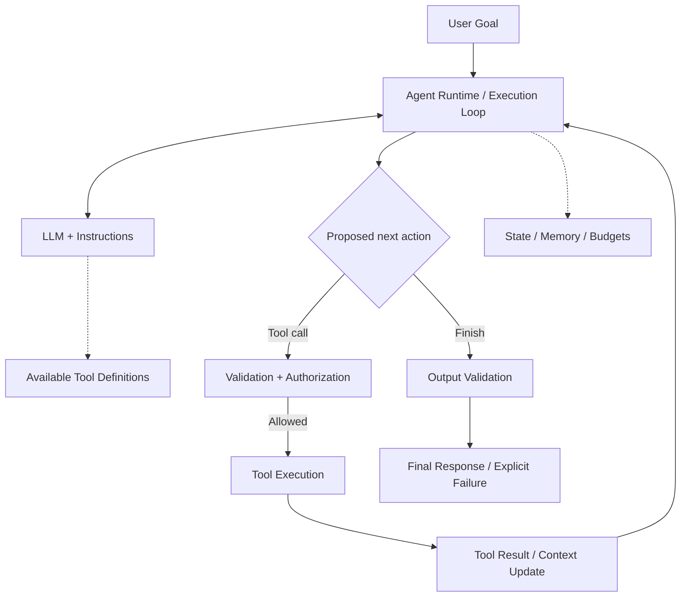

This diagram shows responsibilities in a typical design. It does not imply that this repository implements a runtime, validation gate, authorization service, or memory store. A denied, invalid, or over-budget action needs a defined failure or escalation path; the execution diagram below makes those paths explicit.

### How an agent executes

For a model-controlled run: (1) receive a goal and context; (2) invoke the model; (3) receive an action proposal or final answer; (4) validate and authorize a proposed tool call; (5) execute it only if permitted; (6) return the result as context; (7) repeat within budgets or terminate; and (8) validate the final output. The application owns authorization and stop rules throughout.

**Illustrative model-controlled agent loop — execution sequence:**

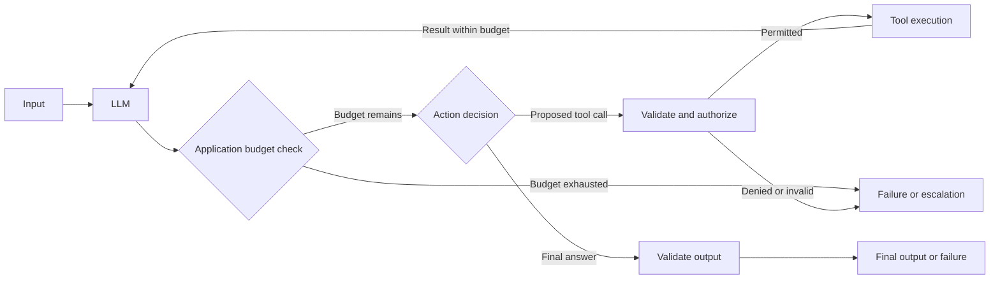

The tool edge is a trust boundary: a prompt or model proposal is never permission to act. This diagram explains **how execution proceeds**; the component diagram above explains **what a typical system contains**. Both are design illustrations, not a runtime supplied by this repository.

## Workflow vs. agent: control strategies

A **workflow** is a process whose allowed stages and transitions are defined by application code. It may call a model or tools, route requests, run branches in parallel, and repeat a bounded step. Its outputs can vary even when the code owns the process. The first architectural question is **who decides what executes next**:

| Control strategy | Next-step owner | Appropriate starting point |
| --- | --- | --- |
| **Conventional software** | Code and explicit human input | Rules, search, calculations, or transactions meet the acceptance criteria without an LLM. |
| **Single bounded LLM call** | Code invokes one model call and handles its result | Language understanding or generation is needed, but the task has a bounded input and output contract. |
| **Code-controlled workflow** | Code determines transitions, including conditions and stop rules | The task needs multiple known stages or branches. Stages may use LLMs, retrieval, and tools. |
| **Model-controlled agent** | A model proposes actions or next steps within code-enforced limits | The useful path varies enough that model-directed choice has demonstrated value. |

A **code-controlled** workflow is not necessarily *deterministic*: an LLM call, external tool result, or model classifier can vary the data and even the chosen branch. In an LLM-based router, the classification outcome is model-dependent while **code still owns the permitted routes, branch mapping, and execution rules**. Conversely, a tool-using loop remains code-controlled if its next step is fixed by those rules. Tool calls and iteration alone do not establish model-controlled autonomy. A model-controlled agent proposes among permitted next steps, while the application validates and authorizes action execution. This distinction is consistent with [Anthropic's workflow and agent definitions](https://www.anthropic.com/engineering/building-effective-agents) and [LangGraph's workflow guide](https://docs.langchain.com/oss/python/langgraph/workflows-agents).

**Illustrative code-controlled workflow:** the application fixes the path, even though retrieval and the LLM may return variable data.

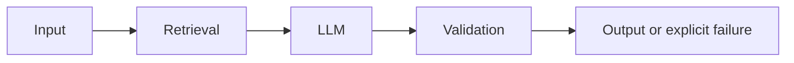

Compare this fixed workflow path with the [agent loop](#how-an-agent-executes): the distinction is who proposes the next action, not whether a model or tool appears in the diagram.

## Three-layer architecture selection model

### Layer 1 — Control strategy

Record the goal, success criteria, data sources, external actions, privacy constraints, expected volume, latency and operating budgets, available team skills, and deployment assumptions. Label each input **known**, **assumed**, or **unknown**. An unknown permission must remain unresolved until an authorized decision is available.

First compare the strongest plausible conventional solution with the LLM proposal. If generation or language interpretation is justified, test whether one bounded call is sufficient. Add a code-controlled workflow when known stages or branches are required. Use model-directed control only when flexible action choice addresses a documented gap and can be evaluated within an explicit tool set, stop condition, and budget. These are **project recommendations**, not universal thresholds.

### Layer 2 — Orchestration patterns

Organize the selected strategy using **sequential**, **parallel**, **router**, **evaluator–optimizer**, **supervisor**, or **handoff** patterns when their requirements arise. They can compose. A parallel phase can occur inside a sequential workflow; a router does not require parallel execution; an evaluator may follow a single agent or a fixed workflow. Each added stage should have a measurable benefit or a required responsibility.

### Layer 3 — Execution and operational design

Choose how to express and run the flow only after its control strategy and orchestration are clear. Ordinary code may suffice. **Graph-based execution** can express branches, cycles, interrupts, and explicit state, but a graph runtime is not required merely because the design has several steps. Separately specify state ownership, checkpoint and recovery needs, authorization boundaries and human approval for high-impact actions, timeout and retry rules, idempotency for side effects, model/tool budgets, observability, and failure outcomes. State and checkpoints are operational capabilities; a graph is an execution representation. Neither determines whether the next step is code-controlled or model-controlled. See [engineering policies](ENGINEERING_POLICIES.md).

Keep framework choice and model/tool integration separate from these layers. Framework-free implementation remains valid; no pattern here implies LangGraph or any other SDK.

## Architecture decision heuristics

### Minimum necessary complexity

Use this short flow to test the minimum architectural complexity supported by the requirements before considering an agent. Each question asks whether that candidate can meet the actual acceptance criteria, not whether it can be prototyped. This is a **reasoning heuristic**, not a mandatory implementation sequence, a universal complexity ranking, an automatic classifier, or proof that simpler designs always perform better.

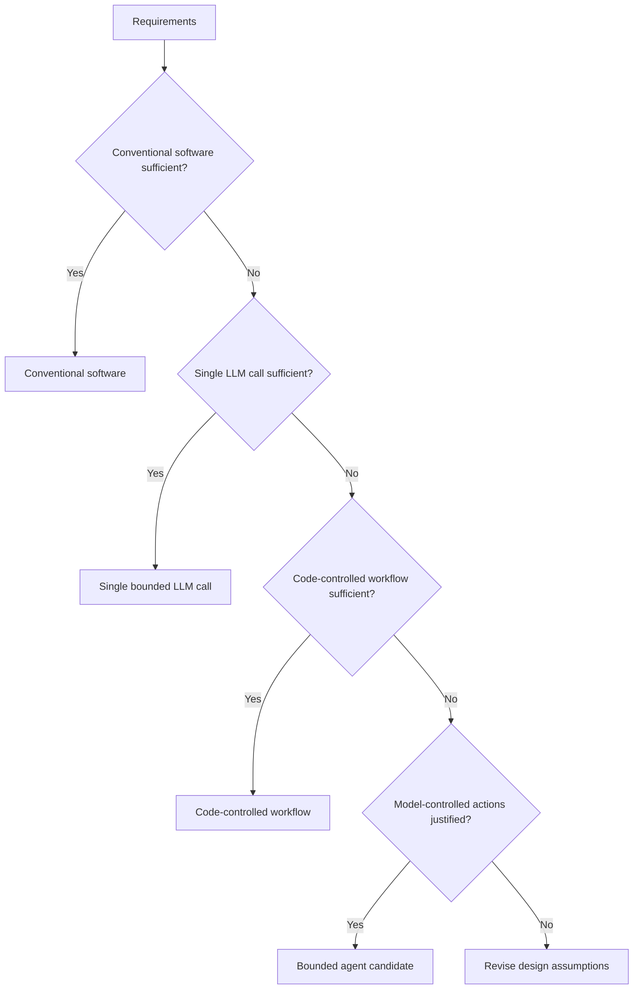

### Three-layer decision heuristic

The next diagram carries a candidate through the **complete proposal process**: Layer 1 control strategy, Layer 2 orchestration needs, Layer 3 execution and operations, alternative comparison, and human review. It is also a **decision heuristic, not an automatic architecture classifier**. Each candidate still requires evidence and explicit assumptions. The two diagrams serve different questions and should not be collapsed into a universal rule.

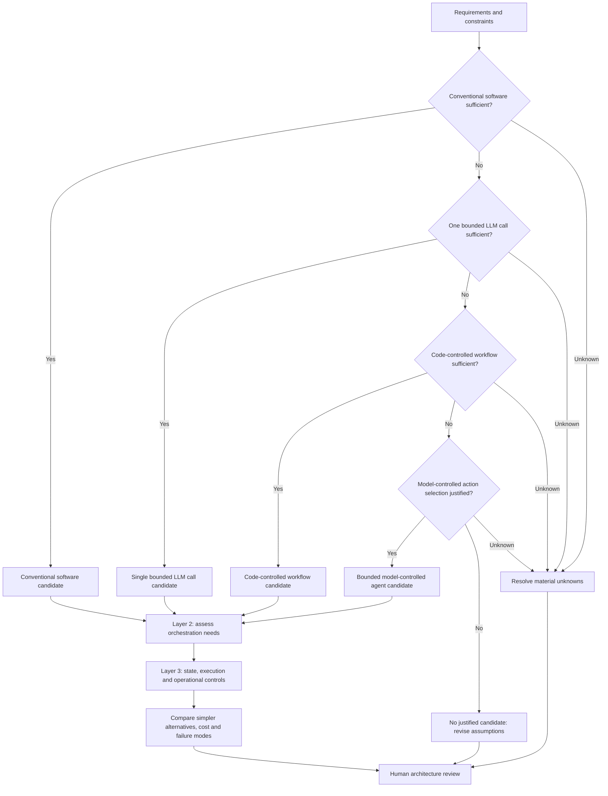

When evidence for model-directed control is missing, keep it an assumption to test rather than silently selecting an agent. The Layer 2 and Layer 3 steps are reviews of requirements, not instructions to add patterns, persistent state, or a graph.

## Orchestration pattern catalog

The table defines each pattern and its **outer control owner**. A stage may contain a model-controlled agent without changing who owns the surrounding workflow.

| Pattern | Definition and control owner | Use when | Main trade-offs |
| --- | --- | --- | --- |
| **Sequential workflow** | Code runs known stages in order. | Later stages depend on earlier outputs; e.g., extract → validate → summarize. | Simple contracts and debugging, but cumulative latency and propagated errors. |
| **Parallel workflow** | Code launches independent branches and joins their results. | Independent retrieval sources or analyses can run concurrently. | Potentially shorter wall-clock time, but higher concurrent cost, rate limits, partial failure, and merge complexity. No router is inherent. |
| **Router** | A rule or classifier selects among defined paths; code owns allowed destinations and dispatch. | Request classes need genuinely different handling, e.g., policy lookup versus report drafting. | Routing error and fallback design; a model classifier adds latency and uncertainty. |
| **Evaluator–optimizer** | A generator produces an output; a criterion checks it; code enforces revise/pass/stop. The evaluator may be code, a model, or a human. | Quality criteria are explicit and revision has measurable value. | Additional calls and evaluator bias; cap revisions and provide failure or escalation. It is about output quality, not necessarily multi-agent delegation. |
| **Supervisor** | A controller delegates bounded specialist tasks, collects results, and retains coordination and final-answer ownership. It may be code- or model-directed. | Distinct expertise, context, or permissions justify specialists whose outputs must be combined. | Coordination latency/cost, context transfer, and controller bottlenecks. |
| **Handoff** | A triage controller transfers active control to a specialist, with application-mediated state and permissions. | A specialist should continue the interaction directly under its own instructions and scoped tools. | Ownership, context, and authorization transfer can be ambiguous; define return and escalation rules. |

### Simple workflow examples

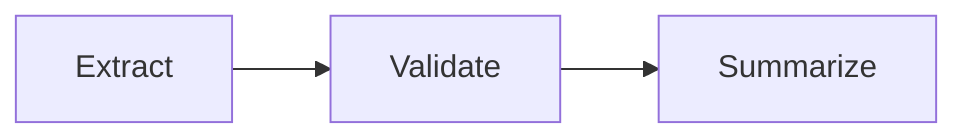

In the **sequential** example, code requires validation before summarization.

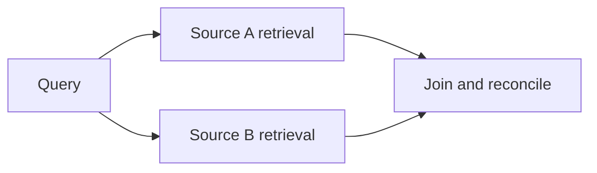

In the **parallel** example, both retrieval calls are independent; the join defines what happens if one fails.

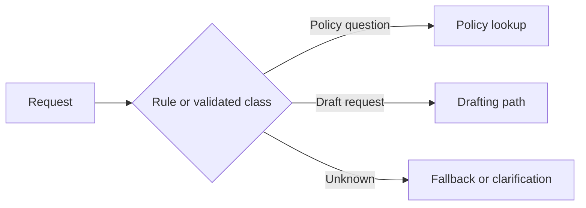

In the **router** example, a classifier may propose the class, while code limits the available paths and handles unknown or invalid classes.

### Feedback, delegation, and control transfer

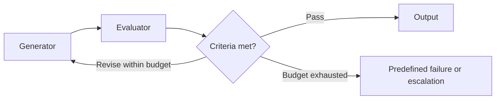

The **evaluator–optimizer** repeats only within a fixed revision budget. Its exhausted-budget outcome must be predefined and proportionate to the risk: an explicit failure may suffice, while consequential cases may need human escalation. A model evaluator's agreement is not independent proof of correctness; the proposal must name acceptance criteria and failure behavior. [Anthropic](https://www.anthropic.com/engineering/building-effective-agents) and [LangGraph](https://docs.langchain.com/oss/python/langgraph/workflows-agents) describe this feedback pattern.

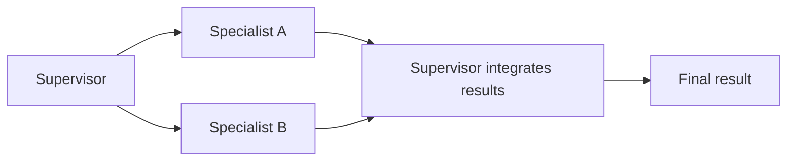

The **supervisor** retains coordination ownership while specialists return bounded results. It need not run specialists in parallel. A model-directed supervisor still passes every tool request through application authorization.

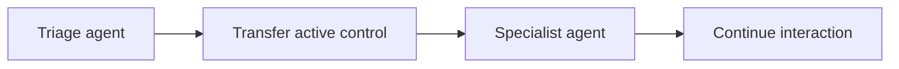

In a **handoff**, the specialist becomes the active owner of the continuing interaction. The application must scope transferred context and recheck permissions; the transfer itself does not grant new authority. The manager-versus-handoff distinction is described in the [OpenAI Agents SDK orchestration guide](https://openai.github.io/openai-agents-python/multi_agent/). That SDK is a terminology reference here, not a required implementation.

### Bounded single agent

A **single agent** belongs to Layer 1 because it chooses next actions, rather than being an orchestration pattern that necessarily requires other agents. Use it when one controller can handle dynamic, bounded tool choice. The trade-off is flexible execution against less predictable trajectories, latency, and cost. Set tool permissions, output validation, and call/iteration limits. [ReAct](https://arxiv.org/abs/2210.03629) studies interleaved reasoning and action, but does not establish safety or performance for this repository.

## Pattern composition

This **illustrative hybrid** handles one eligible request class through a rule-based router, parallel read-only retrieval, a bounded single agent, and an evaluator. Another class takes a simpler fixed path.

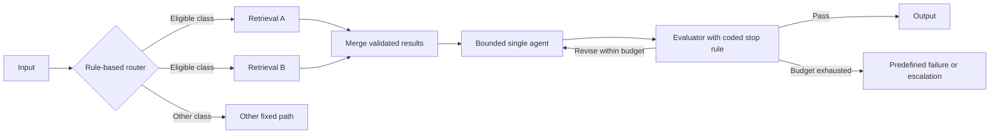

**Code controls** class rules, dispatch, concurrent retrieval, merge validation, permissions, budgets, and the evaluator's stopping policy. **The model controls** action proposals inside the bounded single agent; an evaluator may be model-, code-, or human-based. The application authorizes any proposed tool use. This combination is justified only if request classes differ, retrieval sources are independent, fixed processing is inadequate for the eligible class, and evaluation criteria warrant revision. Otherwise remove the unnecessary element.

## Trade-offs, validation & human review

For each candidate, document expected **complexity, end-to-end latency, model/tool cost, state and recovery needs, failure modes, authorization boundary, and maintenance burden**. Compare it with at least one simpler alternative: conventional software, one call, or a fixed workflow. Identify what evidence would justify a more complex pattern, such as distinct permissions, context isolation, measured quality gain, or separate ownership.

Use the [system design template](../templates/SYSTEM_DESIGN.md) to tie requirements to components, editable diagrams, failure paths, and acceptance criteria. Human architecture review should resolve material unknowns and approve the design before substantial implementation. Revisit it when measured quality, scale, latency, cost, permissions, or recovery needs change. Retrieval, memory, checkpoints, human approval, and observability are cross-cutting capabilities, not mutually exclusive topologies.

### Selection contract for coding agents

After consulting this guide, produce a **proposal for human review** that states:

- Requirements, assumptions, and unresolved questions.
- The selected control strategy, orchestration patterns, and execution/operational design.
- At least one simpler alternative, the decision rationale, and cost, latency, state, reliability, and maintenance trade-offs.
- Security and authorization boundaries, failure and recovery behavior, acceptance criteria, and verification approach.
- Issues requiring human approval before substantial implementation.

Use the [system design template](../templates/SYSTEM_DESIGN.md) for the full structure and the [engineering policies](ENGINEERING_POLICIES.md) to assess applicable controls. Label unknowns and unverified claims. A design proposal alone does not verify architectural compliance, runtime correctness, or production readiness.

## References & limitations

The working definition of workflow versus agent and the named workflow patterns draw on [Anthropic's engineering article](https://www.anthropic.com/engineering/building-effective-agents) and [LangGraph's pattern guide](https://docs.langchain.com/oss/python/langgraph/workflows-agents). The [OpenAI Agents SDK overview](https://openai.github.io/openai-agents-python/) illustrates agent configuration, tools, guardrails, and runtime loops; its [orchestration guide](https://openai.github.io/openai-agents-python/multi_agent/) distinguishes a manager retaining control from a handoff to an active specialist. [ReAct](https://arxiv.org/abs/2210.03629) studies interleaved model reasoning and actions. These sources describe research or framework capabilities, **not validation of this project's diagrams or selection heuristics**.

This guide synthesizes those sources into **project recommendations**. Its heuristic and hybrid example have not been benchmarked or implemented here. Pattern terminology varies across frameworks. Published examples do not establish model compatibility, authorization, reliability, or production readiness for a new application; verify those properties in its own environment. Requirements that would change permissions, acceptance, or failure handling need an owner decision rather than an invented default.
