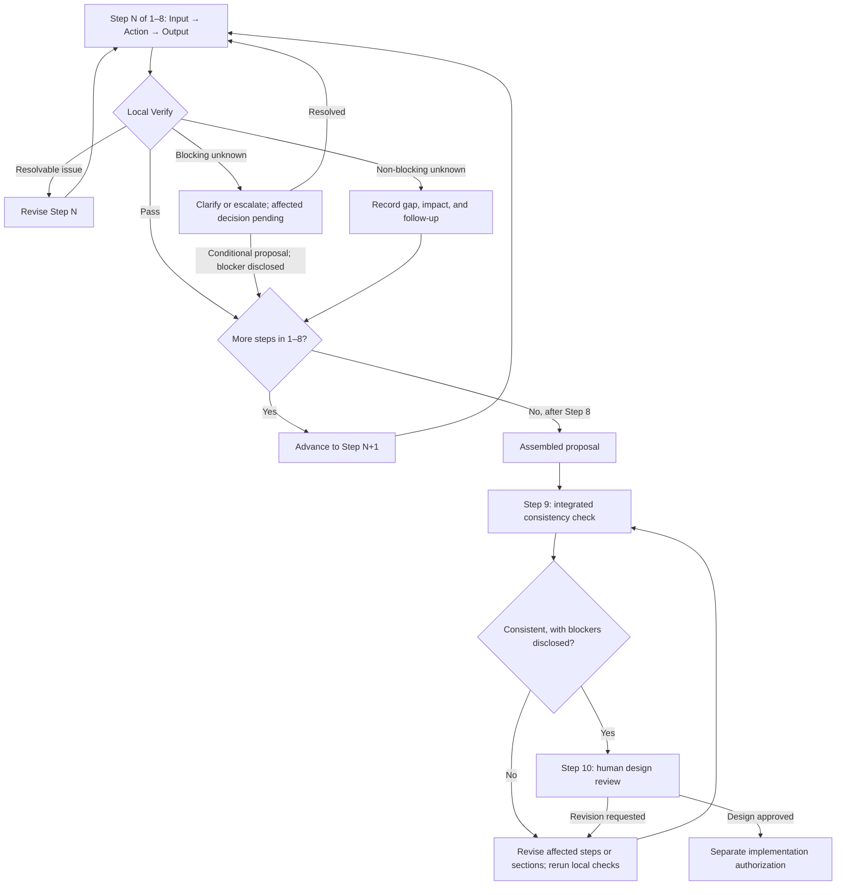

# Procedure Design

This document explains the [agent-system-design Skill](SKILL.md) for maintainers and engineering reviewers. Normal use needs only `SKILL.md` and its linked architecture, policy, and template references.

## Why the procedure has ten steps

Steps 1–2 establish requirements and the reliability of inputs. Steps 3–5 follow the [approved three-layer architecture model](../../docs/ARCHITECTURE_SELECTION.md): control strategy, orchestration, then execution and operations. Step 6 tests the choice against simpler alternatives. Step 7 applies the [engineering policies](../../docs/ENGINEERING_POLICIES.md). Step 8 assembles the [proposal template](../../templates/SYSTEM_DESIGN.md). Step 9 checks the integrated design, and Step 10 gives the decision to an authorized human. This order keeps framework and model choice downstream of the architectural need without requiring every proposal to use an agent or graph.

## Input, Action, Output, Verify

Each step consumes available information (**Input**), performs a concrete decision or drafting task (**Action**), adds to working notes or the proposal (**Output**), and runs a proportionate local completion check (**Verify**). These outputs are not ten separate files. The proposal is the main artifact; the checks catch omissions early without creating ten approval gates or asking for private model reasoning.

| Step | Local completion check |
| --- | --- |
| 1. Requirements | Material requirements and acceptance cases are recorded or explicitly unknown. |
| 2. Classification | Facts, assumptions, and blocking questions are distinct; unknown permission is not assumed. |
| 3. Layer 1 | Four control candidates were compared against requirements; autonomy has a reason. |
| 4. Layer 2 | Each orchestration pattern has a purpose and named control owner. |
| 5. Layer 3 | Execution, authorization, limits, recovery, and failure outcomes are addressed proportionately. |
| 6. Alternatives | A credible simpler option and the selected design's costs and trade-offs are visible. |
| 7. Policies | Policy applicability, stage, evidence gaps, and review ownership follow the policy guide. |
| 8. Proposal | Template sections, diagrams, failure paths, and requirement-linked tests are present or marked as gaps. |
| 9. Consistency | Integrated sections agree; unresolved contradictions and unavailable diagram checks are disclosed. |
| 10. Human review | Approval questions and implementation boundaries are explicit; the agent has not self-approved. |

## Unknowns and revision

A **blocking unknown** prevents a defensible architectural commitment, authorization decision, or safe implementation recommendation. Ask an authorized person to resolve it. A conditional proposal may still be useful, but the affected decision stays pending and does not authorize implementation. Examples include sensitive-data access authority and consequential-action permissions. A **non-blocking unknown** permits a conditional design when its impact and resolution path are recorded, such as an estimated future volume or unselected model provider. Neither category uses a universal numeric threshold.

If a local check fails, correct the current step when possible, revisit earlier affected decisions, or escalate a blocker. Carry a non-blocking gap forward with its impact and needed evidence. Human-requested revisions follow the same rule: revisit affected steps, update the proposal, then run Step 9 again.

**Advance to Step N+1** moves to the next step, while targeted revisions return only to affected work. An unresolved blocker can move forward only as a disclosed conditional decision, never as a passed local check or permission to act.

## Final check and approval boundary

Steps 1–8 verify their own outputs. Step 9 checks relationships across the assembled proposal: requirements and acceptance, architecture and alternatives, components and diagrams, authorization and policy records, failure paths and tests, and unknowns and approval decisions. Mermaid parsing or rendering is a syntax aid when available; it is not proof that runtime controls work. Inconsistencies cause targeted revision and another integrated check.

Step 10 presents the consistent or explicitly conditional proposal to a human reviewer. The reviewer may request revisions or approve the design. Design approval is distinct from implementation authorization; later implementation verification requires observable evidence from the actual system. The Skill never supplies its own approval.

## Maintenance principles

Keep the [Skill](SKILL.md) self-contained for execution and these supplementary documents explanatory. Preserve the ten-step order, the three-layer model, stable Policy IDs, DESIGN versus IMPLEMENTATION evidence, and human approval. Link to authoritative guides instead of copying their policy catalog. Add procedural detail only when it changes an agent's decision or catches a real omission; avoid project-specific habits, mandatory framework choices, and unverified runtime claims.
