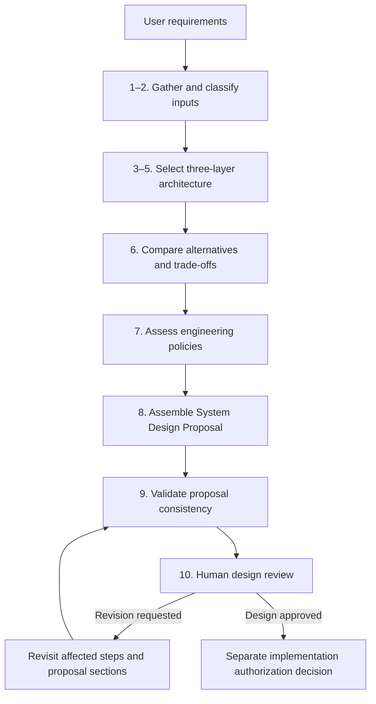

# Agent System Design Skill

This Skill helps a coding agent turn a system requirement into a reviewable **System Design Proposal**. Use it when a project needs an explicit choice between conventional software, a bounded LLM call, a code-controlled workflow, and a model-controlled agent, with engineering controls considered before implementation.

Provide the goal, users, success criteria, data sources, external actions, and known constraints. The Skill asks about material gaps and records assumptions and unknowns. The result is a proposal with architecture rationale, alternatives, editable diagrams, applicable policy records, proposed verification, and decisions for human review. It appears in the agent conversation by default; save it as Markdown only when the user requests a file and provides or approves its destination.

## Workflow

Revisions revisit the affected decisions and then repeat the consistency check; they need not restart every step. Human approval of a design does not execute or verify an implementation.

## Documents and responsibilities

| Document | Role |
| --- | --- |
| [SKILL.md](SKILL.md) | Standalone agent procedure with input, action, output, and local check for each step. |
| [Architecture Selection](../../docs/ARCHITECTURE_SELECTION.md) | Authoritative three-layer selection guidance. |
| [Engineering Policies](../../docs/ENGINEERING_POLICIES.md) | Policy applicability, evidence, and approval rules. |
| [System Design Template](../../templates/SYSTEM_DESIGN.md) | Output structure for the proposal. |
| [DESIGN.md](DESIGN.md) | Maintainer rationale for verification and revision behavior. |

An authorized human reviews assumptions, trade-offs, policy and authorization decisions, and remaining risks. The agent cannot approve its own proposal; substantial implementation requires a separately authorized scope.
