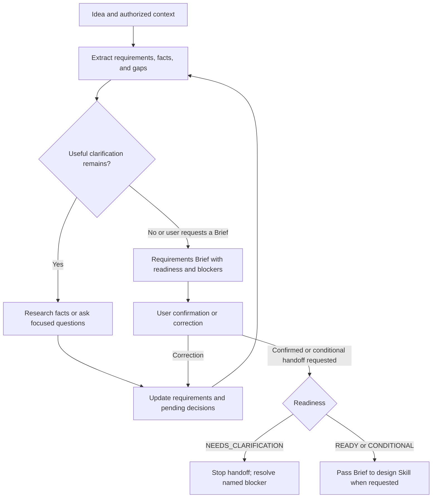

# Requirements Clarification

This Skill helps engineers, project owners, and coding agents turn an incomplete idea into a compact **Requirements Brief** that a human can confirm and an architecture designer can use.

Use it when goals, scope, acceptance criteria, data access, or external actions are unclear. Skip it when direct requirements are already sufficient for the [Agent System Design Skill](../agent-system-design/SKILL.md). It is optional; every project need not pass through both Skills.

## How the conversation works

The agent extracts existing information first, investigates useful facts through authorized sources, and asks a few questions that change the requirements. It considers question dependencies, offers options or recommendations when useful, and reuses prior answers. Usually one to three questions fit a round; the number adapts to what matters. Deferred details stay visible, so the interview can stop when further questions add little value.

The Brief covers goal/users, requirement IDs, scope and data/actions, acceptance cases, constraints and evidence, assumptions/unknowns, open decisions, readiness, and user confirmation. User-stated and verified facts remain distinguishable from recommendations.

| Readiness | Handoff meaning |
| --- | --- |
| READY_FOR_DESIGN | Architecture design can begin without an unresolved central blocker. |
| CONDITIONAL_FOR_DESIGN | A useful conditional design is possible; specified decisions or permissions stay pending. |
| NEEDS_CLARIFICATION | A fundamental blocker prevents a defensible design handoff; name it and its decision owner. |

Readiness and confirmation are independent. A ready Brief may still await confirmation. Confirming intent does not approve architecture, protected-data access, implementation, or runtime behavior.



While a response is pending, confirmation stays awaiting. Corrections update affected requirements; unresolved blockers never become permissions. The integration is a shared Brief and explicit instructions to read the [design Skill](../agent-system-design/SKILL.md), whose [proposal template](../../templates/SYSTEM_DESIGN.md) covers architecture, contracts, policy assessment, and implementation handoff. This repository supplies no orchestrator or required cross-Skill API.

## Usage prompt

```text
Read skills/requirements-clarification/SKILL.md and help clarify this idea:
[Goal, users, existing context, and constraints I already know.]
Extract supplied facts first. Research useful facts only within authorized
sources, then ask a few high-value questions with options where helpful.
Produce the Requirements Brief in this conversation, including readiness,
pending permissions, and questions requiring my decision. Ask me to confirm
or correct it. Leave architecture selection to agent-system-design/SKILL.md.
```

## Illustrative interaction

**User:** "I want AI customer support for our product."

**Agent:** "Who will use the first version: customers directly or support staff? What should it handle first: help-page questions, account-specific information, or changes such as refunds? I recommend starting with help-page questions if that meets your goal, since account access and changes need separate authority decisions. 'Not sure' is fine."

**User:** "Support staff only, using public help pages. No account data or refunds."

**Agent:** "I have R1: help staff answer questions from public help pages, and R2: exclude account access and external changes. What would make a useful answer acceptable, and what should happen when the pages do not support one? I can record undecided targets as unknown."

The next Brief preserves these requirements and any missing acceptance decisions. It does not infer a model, agent topology, or data permission. This interaction is illustrative, not a live-agent test.

## Inspiration & Attribution

Conceptual inspiration came from Matt Pocock's [skills project](https://github.com/mattpocock/skills), [Grill Me](https://github.com/mattpocock/skills/tree/main/skills/productivity/grill-me), and [Grilling](https://github.com/mattpocock/skills/tree/main/skills/productivity/grilling): consider decision dependencies, include useful recommendations, and investigate discoverable facts. The upstream [LICENSE](https://github.com/mattpocock/skills/blob/main/LICENSE) was checked on 2026-10-26 and identifies the MIT License, with copyright attributed to Matt Pocock (2026).

This procedure and documentation were independently authored without copying upstream prose or structure. They use selective questioning, an explicit sufficiency stop, and a Requirements Brief handoff rather than an exhaustive interview. Neither upstream Skill is installed or required, and no upstream endorsement is implied.
