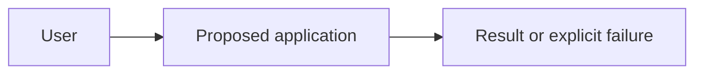
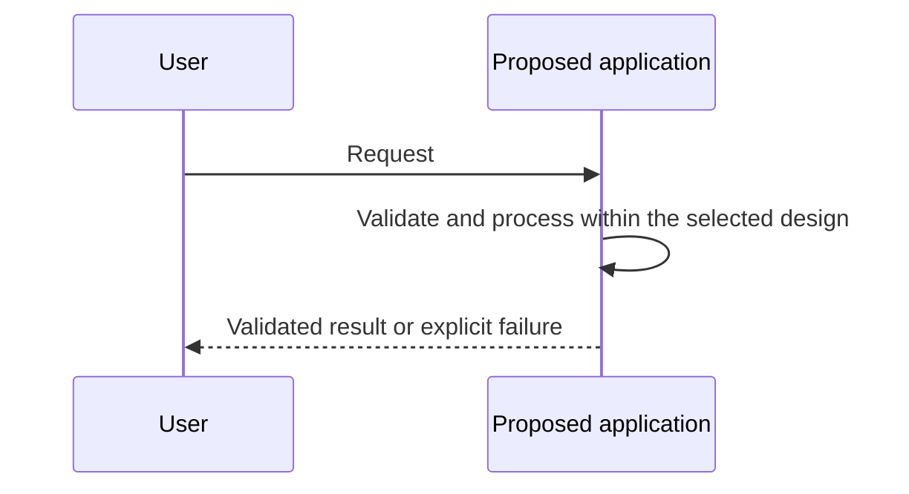

# System Design Proposal — [Project]

**Design status:** [PROPOSED / CONDITIONAL — pending authorized human review]

**Owner / date:** [Name or role] / [Date]

**Implementation authorization:** PENDING

This is the output contract for the [Agent System Design Skill](../skills/agent-system-design/SKILL.md). Use the [architecture selection guide](../docs/ARCHITECTURE_SELECTION.md) and [engineering policies](../docs/ENGINEERING_POLICIES.md) as authoritative references. Replace prompts with concise decisions and reviewable engineering rationale. Mark material inputs **KNOWN / ASSUMED / UNKNOWN**; do not invent requirements, permissions, API fields, or numeric targets.

Keep the proposal proportional to the system. Conventional software, framework-free designs, and designs without models, tools, graphs, or persistent state are valid. Mark irrelevant items **NOT_APPLICABLE** with a reason and unresolved details **UNKNOWN**. The structure, contracts, diagrams, and snippets must describe the same proposed architecture.

Present the proposal in the coding-agent conversation by default. Save Markdown only when explicitly requested and the destination is provided or approved. Directory trees and snippets describe the design: do not create implementation files or execute illustrative code. Snippets are not verification evidence.

## 1. Requirements & Constraints

- **Goal and intended users:** [Who needs what outcome?]
- **Inputs, outputs, data sources, and external actions:** [Read/write scope, sensitivity, external owners, and known authority]

| Requirement ID | Type | Requirement and input status | Acceptance criterion, including failure cases |
| --- | --- | --- | --- |
| R1 | [Functional / non-functional] | [Statement; KNOWN / ASSUMED / UNKNOWN; source] | [Observable success and negative outcome, or unresolved criterion] |

| Constraint | Value and input status | Design impact |
| --- | --- | --- |
| [Security, privacy, cost, latency, availability, deployment, team, or other relevant constraint] | [Value; KNOWN / ASSUMED / UNKNOWN] | [What this limits or leaves conditional] |

| Unknown or assumption | Blocking / non-blocking | Impact and affected decision | Decision owner and resolution needed |
| --- | --- | --- | --- |
| [Missing fact or explicit assumption] | [Classification and reason] | [Architecture, acceptance, data access, or implementation impact] | [Authorized owner if known; evidence or clarification needed] |

Blocking unknowns keep affected decisions pending. Non-blocking unknowns may remain in a defensible conditional proposal with their impact and follow-up recorded.

## 2. Architecture Decision Record

### Layer 1 — Control Strategy

| Candidate | Suitability against requirements | Rationale, evidence, or gap |
| --- | --- | --- |
| Conventional software | [Requirements met or unmet] | [...] |
| Single bounded LLM call | [...] | [...] |
| Code-controlled workflow | [...] | [...] |
| Bounded model-controlled agent | [...] | [...] |

**Recommended candidate and justification:** [One Layer 1 recommendation tied to requirement IDs; why language generation or model-directed action is or is not needed. Mark CONDITIONAL when material evidence or decisions remain unresolved. A conditional candidate is provisional and is not human-approved.]

### Layer 2 — Orchestration

**Patterns, composition, and control ownership:** [Justified sequential, parallel, router, evaluator–optimizer, supervisor, or handoff patterns; or none. State the owner of transitions, delegation, and final results.]

### Layer 3 — Execution & Operations

**Execution representation and high-level operational design:** [Ordinary code or graph if justified; state and recovery needs, execution boundaries, and operational consequences. Detailed control mechanisms and owners belong in §7.]

- **Credible simpler alternative:** [What it satisfies and where it falls short; if already minimal, explain why no simpler option meets the requirements]
- **Other rejected alternatives:** [Reasons for rejection]
- **Trade-offs:** [Quality, complexity, cost, latency, security, reliability, and maintenance]
- **Evidence gaps and revision triggers:** [What evidence is missing and what change would require reconsideration]
- **Technology assumptions, separate from architecture:** [Language, framework-free or SDK choice, model capabilities/provider if relevant, tools, versions, and deployment assumptions; UNKNOWN or NOT_APPLICABLE where appropriate]

## 3. System Structure & Component Responsibilities

Provide a concrete logical module or directory tree proportional to the selected design. Use actual proposed names; add components only when justified. A language-neutral module tree is valid when implementation conventions are undecided. This tree does not authorize file creation.

```text
[system or logical root]/
  [module name]  — [responsibility]
  [additional module only if justified]
```

| Component / module / path | Responsibility | Dependencies and external integrations | State owned | Trust boundary and control owner |
| --- | --- | --- | --- | --- |
| [Proposed name] | [One clear responsibility] | [Other modules, services, tools, or none] | [State and lifecycle, or none] | [Who controls execution and which boundary is crossed] |

**Primary control owner:** [Component responsible for the next step and termination. Identify external owners of authorization, validation, tool execution, and any persistent state where applicable.]

## 4. Interface, Data & Error Contracts

Describe key request/response shapes, component interfaces, tool schemas, and external side-effect boundaries. Use contract IDs that diagrams, snippets, tests, and work packages can reference. Mark unresolved fields or permission decisions explicitly; keep framework/model choices separate from these contracts.

| Contract ID | Producer → consumer | Input / output shape or schema | Validation and authorization boundary | Error contract and side effects |
| --- | --- | --- | --- | --- |
| C1 | [Named components] | [Required fields/types or unresolved schema] | [Owner, data scope, checks] | [Typed failure/outcome; read/write effect or none] |

| Data or state | Shape, classification, and trust level | Owner and lifecycle | Permitted access, retention, and unresolved decisions |
| --- | --- | --- | --- |
| [Request, tool result, execution state, stored record, etc.] | [Fields/schema; known classification or UNKNOWN] | [Component/system; creation, update, recovery, deletion] | [Approved scope or pending decision] |

## 5. Architecture & Request Sequence Diagrams

Replace both illustrative placeholders with editable Mermaid for this proposed system. Names and edges must agree with §§2–4 and §6, including execution ownership, interfaces, data flow, external systems, and trust boundaries. Do not introduce an agent when the selected design does not need one.

### System architecture



### Representative request sequence



**Authorization and negative paths:** [Show authorization before consequential side effects. Describe denied actions, invalid inputs/outputs, tool or dependency failures, timeouts, cancellation, uncertain writes, and escalation where relevant. Use alt branches when they improve clarity; mark irrelevant paths NOT_APPLICABLE.]

**Diagram validation:** [Checks actually performed and unavailable parsing/rendering. A rendered diagram is not runtime-correctness evidence.]

## 6. Core Logic & Design-level Code

Include selective pseudocode or illustrative code for the most important architectural behavior: control flow, routing, state transitions, authorization enforcement, tool execution, error propagation, or minimal types. Approximately one to three concise snippets may help; use only what clarifies this design, and explain an omission for a trivial case. Each snippet must name its related components/contracts and the decision it expresses.

**Snippet — [Title / architectural decision]:** [Pseudocode / illustrative code; unexecuted and unverified]

**Related components and contracts:** [Names and IDs from §§3–4]

```text
[Insert concise design-level logic for the selected critical path,
including relevant failure and authorization branches.]
```

For authorization-sensitive operations, show argument validation, application/tool authorization, and applicable approval or pre-authorization checks before execution; a model proposal or prompt cannot grant permission. Avoid full applications, large scaffolds, decorative boilerplate, fake imports, and invented library APIs presented as verified. Do not execute these snippets or report them as tested implementation.

## 7. Execution & Operational Controls

Specify concrete proposed mechanisms and enforcement owners, rather than repeating the architecture rationale in §2. Cover actual risks proportionately: identity and permissions; tool allowlists and argument validation; AUTH-02 approval or reviewed pre-authorization; protected data and secrets; state and recovery; deadlines, retries, idempotency, and cancellation; call/cost/iteration/concurrency budgets; sanitized observability; failure states and escalation. Use NOT_APPLICABLE with a reason when a capability is absent.

| Control or risk | Owner / enforcement boundary | Proposed mechanism and failure outcome | Verification status and evidence gap |
| --- | --- | --- | --- |
| [Relevant control; Policy ID where useful] | [Component or external authority] | [Concrete contract, limit or rule; deny/fail/reconcile/escalate behavior] | [Proposed / observed evidence reference; missing evidence] |

**AUTH-02 mode, if applicable:** [Consequence assessment; per-action approval or proposed pre-authorization; approver/decision owner, scope, limits, expiry, explicit risk acceptance, audit, recovery/reconciliation, and escalation. The reviewer must approve pre-authorization before use.]

## 8. Engineering Policy Assessment

Assess every existing Policy ID: **SEC-01, SEC-02, AUTH-01, AUTH-02, REL-01, REL-02, RES-01, OBS-01, EVAL-01, EVAL-02**. Use the [policy guide](../docs/ENGINEERING_POLICIES.md) for authoritative triggers, definitions, evidence, and exceptions. Include one applicability record per ID; add separate stage records only when that stage is assessed.

| policy_id | applicability | stage | status | reason | required_evidence | evidence_reference | review_owner |
| --- | --- | --- | --- | --- | --- | --- | --- |
| [Existing ID] | [REQUIRED / CONDITIONAL / NOT_APPLICABLE] | [DESIGN for applicable policies] | [PASS / FAIL / NEEDS_EVIDENCE / NOT_EVALUATED] | [Trigger, unresolved condition, or concrete absent trigger] | [Evidence required for this stage] | [Proposal section/artifact or missing] | [Designated human reviewer] |

Initial applicable records are DESIGN-stage assessments. For NOT_APPLICABLE, record the absent trigger and reconsideration condition; stage/status may be left as an em dash because no control verification applies. For CONDITIONAL, name the unresolved trigger and decision owner; it cannot PASS until resolved. Missing or inconclusive evidence is NEEDS_EVIDENCE. A coding agent cannot self-approve DESIGN PASS. Any later IMPLEMENTATION record is separate and requires observable evidence from the actual control in its target environment before PASS; prose, diagrams, and illustrative code do not establish it.

## 9. Verification & Acceptance Plan

| Requirement ID | Component or contract | Test / evaluation type | Proposed scenario | Pass criterion | Evidence still required |
| --- | --- | --- | --- | --- | --- |
| R1 | [Module / C1 / diagram node] | [Deterministic / model evaluation / integration / authorization-security / environment-specific] | [Success or negative case] | [Observable criterion; unresolved target if unknown] | [Test result, dataset, environment, trace, or review needed] |

Include relevant denied-access, invalid-input, failed-dependency/tool, timeout, cancellation, limit-exhaustion, and recovery cases. Keep model-dependent evaluations distinct from deterministic checks. State assumptions about test data and target environments. This is a proposed plan; do not invent measured results or claim runtime tests have passed.

**Proposal consistency record:** [Checks actually performed across requirements, architecture decisions, module tree, contracts, diagrams, snippets, policy records, tests, and pending decisions; remaining conflicts and revision needs. Document agreement does not establish runtime correctness.]

## 10. Implementation Handoff & Human Approval

### Work packages

Order work packages by dependency where useful. Keep granularity practical and reference the contracts, controls, and acceptance cases above.

| Work Package ID | Objective | Components / modules | Dependencies | Relevant contracts | Controls / Policy IDs | Acceptance tests | Blockers / approval dependencies |
| --- | --- | --- | --- | --- | --- | --- | --- |
| WP1 | [Concrete outcome] | [Names/paths from §3] | [Other WPs, systems, or decisions] | [C1, state/schema contracts] | [Required controls and existing IDs] | [Requirement IDs and scenarios from §9] | [Pending authority, evidence, or decision owner] |

### Decisions and proposed scope

| Open decision or risk | Owner | Current position / condition | Approval or evidence needed |
| --- | --- | --- | --- |
| [Architecture choice, sensitive-data boundary, unresolved permission, conditional candidate/policy, exception, or residual risk] | [Authorized person/role or UNKNOWN] | [Provisional recommendation; affected work package] | [Decision or evidence that unblocks it] |

- **Proposed implementation scope:** [Included and excluded work packages; capabilities and data/action limits]
- **Remaining evidence gaps and residual risks:** [Including conditional policies and any unverified controls]
- **Redesign conditions:** [Quality, scale, cost, latency, permissions, state/recovery, or ownership changes that require a new decision]

### Approval records

| Record | Status | Authorized reviewer / date | Scope and conditions |
| --- | --- | --- | --- |
| Design approval | PENDING | [Leave unresolved until explicit human acceptance] | [Accepted architecture decisions, reviewed assumptions/blockers, conditions] |
| Implementation authorization | PENDING | [Separate explicit authorization] | [Authorized work packages, data access, action limits, and conditions] |

A proposed architecture, a human-approved architecture decision, a separately authorized implementation scope, and verified implementation behavior are distinct states. Keep approval pending until an authorized human explicitly supplies it. Design approval does not itself authorize implementation or prove runtime controls work. This template alone grants no permission to implement, deploy, or execute tools.
